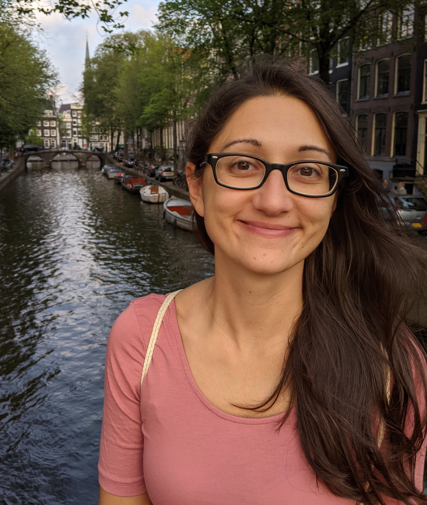

I am an Assistant Professor (tenured) in the [Department of Mathematics and Computer Science](https://www.tue.nl/en/our-university/departments/mathematics-and-computer-science) at the Eindhoven University of Technology ([TU Eindhoven](https://www.tue.nl)).
 

My research lies at the interface between theoretical and applied statistics, with a focus on multivariate statistics and dependence modeling. I am particularly interested in understanding the mathematical foundations of dependence structures through a geometric lens, and in developing statistical methods for modeling complex multivariate data.
 

My research also extends to probabilistic weather forecasting, where I develop statistical methods to better represent uncertainty and dependence in weather predictions, in close collaboration with meteorologists at national weather agencies, particularly the Royal Netherlands Meteorological Institute ([KNMI](https://www.knmi.nl/home)) and [GeoSphere Austria](https://www.geosphere.at/en).
 

Before joining TU Eindhoven, I was a postdoctoral fellow at the [Institute for Data, Systems and Society](https://idss.mit.edu/) of [MIT](https://www.mit.edu) (Cambridge, MA), and an Assistant Professor at the  [University of Massachusetts Lowell](https://www.uml.edu/sciences/mathematics/) (USA). I have also held research positions at [IST Austria](https://ist.ac.at/en/home/) and [GeoSphere Austria](https://www.geosphere.at/en). I hold a MSc in Mathematics from the [University of Salento](https://international.unisalento.it/departments/mathematics-and-physics) (Italy) and a PhD in Mathematics from [JKU Linz](https://www.jku.at/en/institute-of-applied-statistics/) (Austria). 
 
 
